# Pixl Memory

**Frogg, a pixel-art frog that sits on your Mac and edits your writing privately.** Select text in any app, click Frogg, and ask "polish this". Your text goes only to a model running inside a NEAR AI Cloud TEE (Intel TDX + NVIDIA confidential GPUs). Before any text leaves the Mac, Pixl Memory checks the hardware attestation. Every reply arrives with a verification result: which enclave produced it, whether it was fresh for this request, and whether its signature matches.

Frogg also has **its own NEAR account with a small balance it spends on its own inference**. The app holds only Frogg's key, never yours, so Frogg's balance is the most it can ever spend.

Built for the **NEAR Hackathon** (Nov 2026). Tracks: **Privacy & Private AI** (primary), Agent Economy, AI Security & Defense.

> Published publicly for NEAR Hackathon judging. No license is granted. See [`LICENSE`](LICENSE).

**Why does Frogg have a wallet?** So it can pay, per request, for the private inference it does for you, out of a purse with a hard bottom. You set a weekly limit (or pause it) in the Wallet bubble; every payment has an on-chain receipt; the app only ever holds Frogg's key. Use cases, controls and what's next: [`docs/PRODUCT-NOTES.md`](docs/PRODUCT-NOTES.md).

**Light on your Mac.** Typical: **0.1% CPU idle** (0.2% asleep in his pond), **1–5% while moving**, about 60 MB of memory. Measured on an Apple-silicon MacBook Pro with `swift scripts/bench-energy.swift`, which watches the running app in 10-second windows, uses the app's own log to tell idle stretches from movement, and skips windows where you were using it. The budget (SPEC R6/D7: under 1% idle) fails the script if it's broken. Settings ▸ Energy shows the live numbers and a 10-minute sparkline.

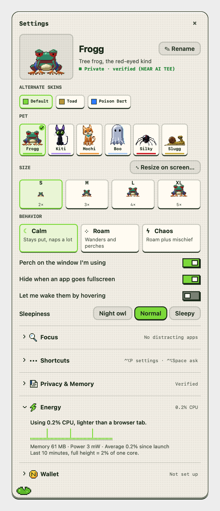

## Screenshots

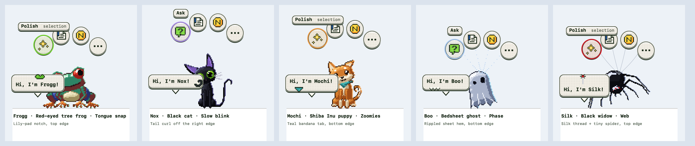
Six Pixls: Frogg (tree frog, the red-eyed kind), Kiti (friendly feline), Mochi (Shiba Inu, professional zoomer), Boo (sheety ghost), Silky (black widow, mostly harmless) and Slugg (definitely a slug). Each has its own accent, menu detail, trick, sounds and walk. Switch in Settings or under More ▸ Change Pixl; memory, wallet and position carry over. Rendered from the Claude Design pixel engine (C7–C15).

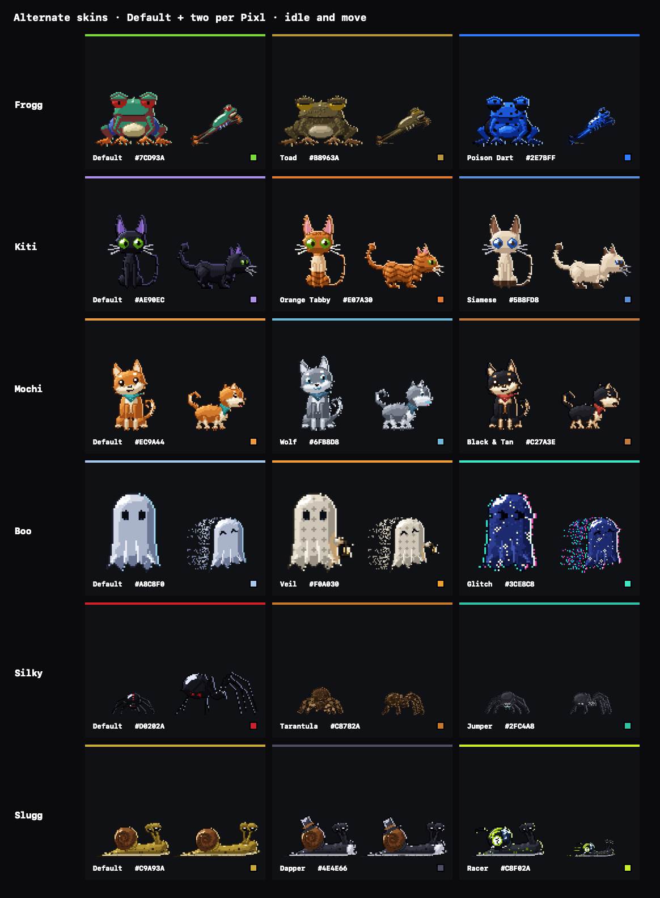
Alternate skins (C15), two per Pixl (three for Kiti), each with its own accent: Frogg Toad and Poison Dart, Kiti Orange Tabby, Siamese and Sphynx, Mochi Wolf and Black & Tan, Boo Veil (a lace veil with a lantern) and Glitch (a starry body that glitches), Silky Tarantula and Jumper, Slugg Dapper and Racer. Pick one under Settings ▸ Alternate skins; each Pixl remembers its own.

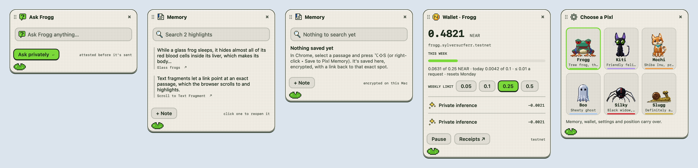
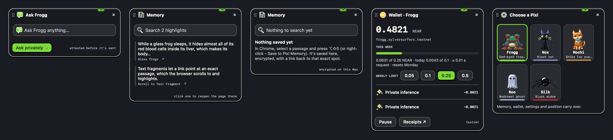
The cards on the C10 Solid material (Liquid Glass is the ghost's alone): header with grip and ×, fields with the Pixl's accent ring, receipts, the Pixl picker.

| | | |
|---|---|---|
| 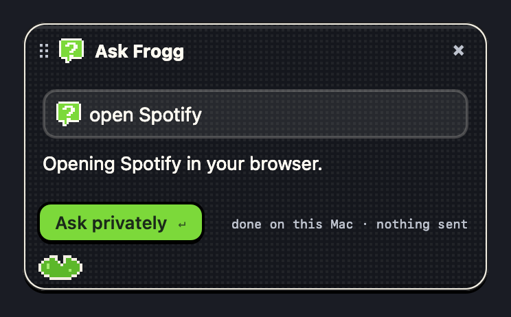 | 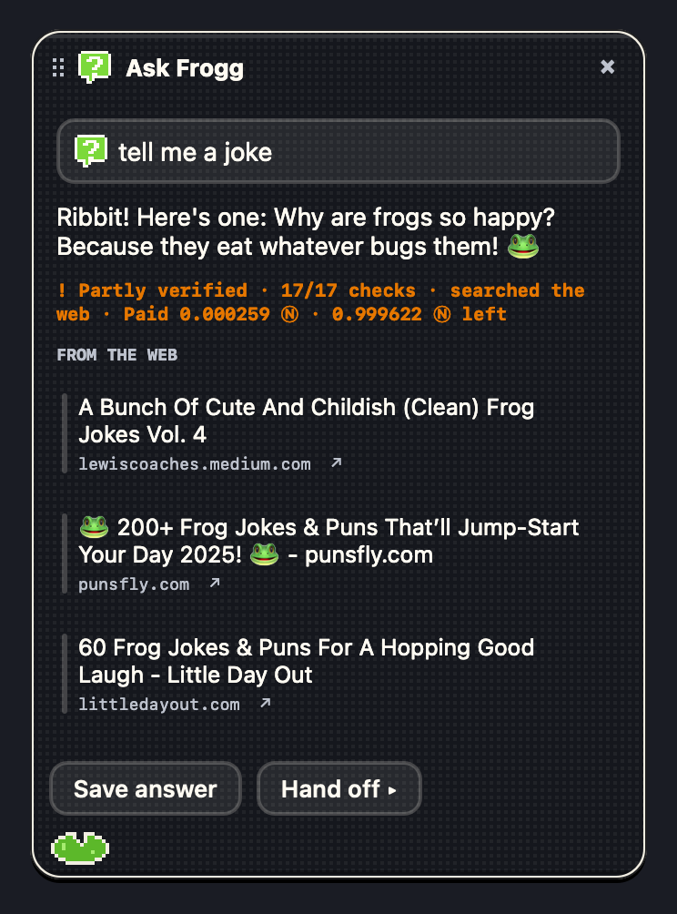 | 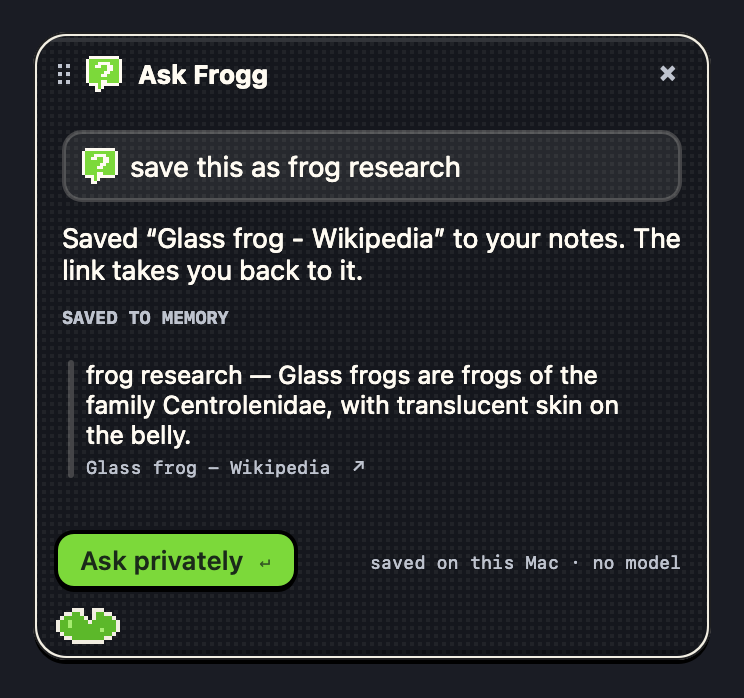 |
| **"open Spotify"**: done on the Mac, no model, nothing sent. | **"tell me a joke"**: a private answer that searched the web, with its sources. | **"save this"**: saved to Memory with a link back to the passage. |

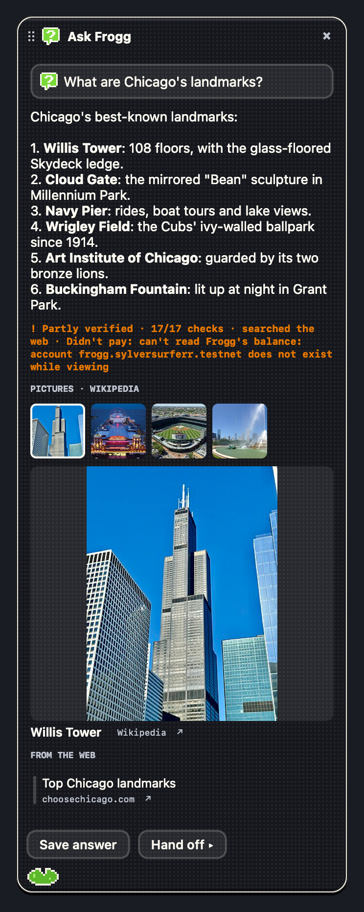
Answers that list places or things show their pictures as small squares (from Wikipedia, looked up by the names only); click one to open it large.

| | |
|---|---|
| 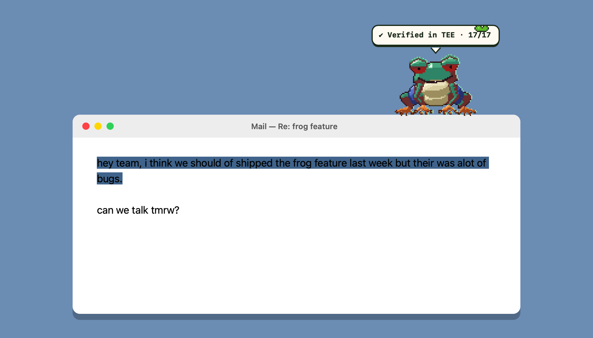 | 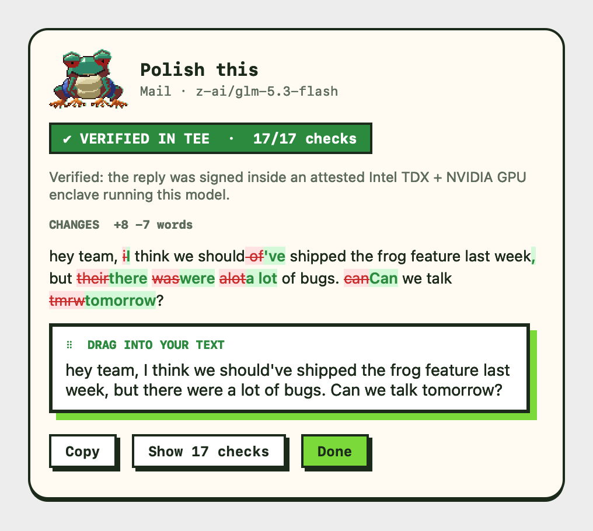 |
| Frogg stands on the title bar of the window you're working in. *(Illustration: the window is drawn; Frogg, the bubble and the panel are the app's real views.)* | **Polish this** on a real NEAR AI Cloud reply: word diff, verdict, and the green-edged card you drag into your text. |
| 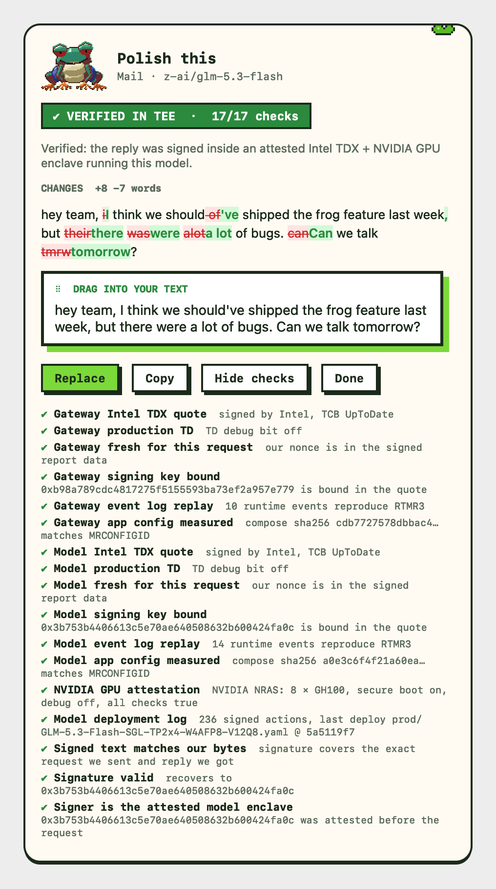 | 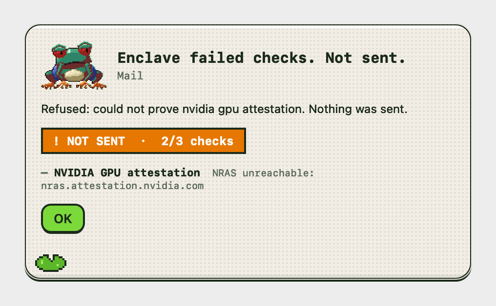 |
| All 17 checks behind the verdict, from the same live request. | If the enclave fails verification, your text is never sent. |
| 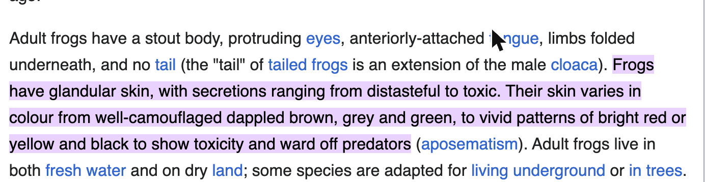 | 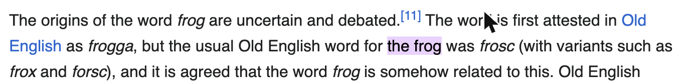 |
| Chrome extension: a saved passage, reopened from its link, scrolled and highlighted. | The link picks the right "the frog" out of 35 on the page. |
| 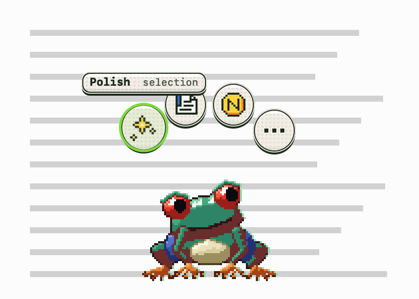 | 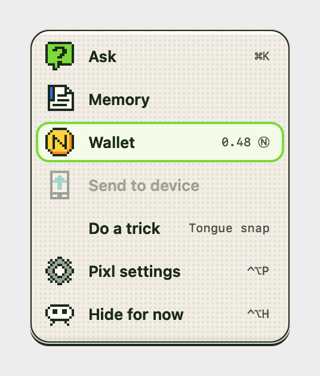 |
| 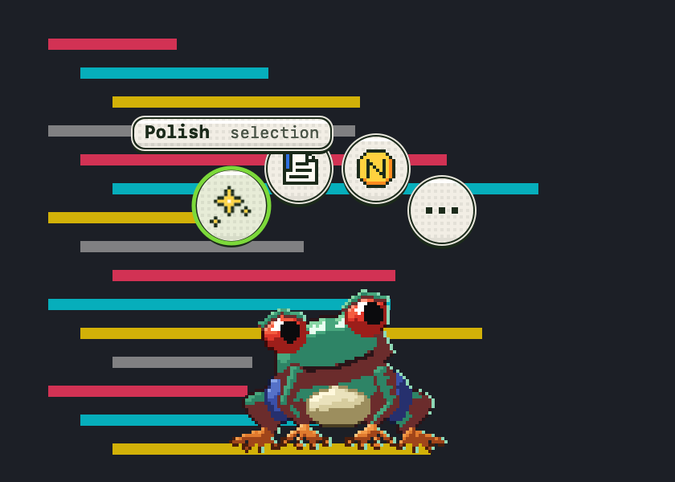 | 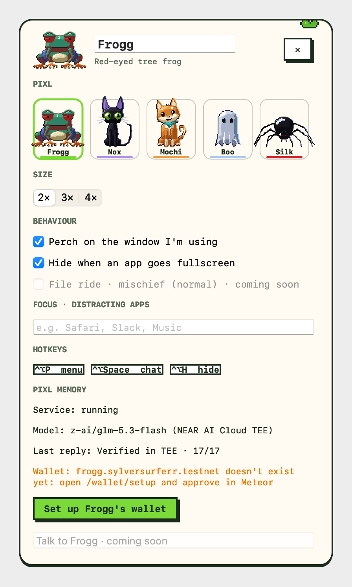 |
| Double-click or right-click the Pixl: Polish (with a selection) or Ask, Memory, Wallet, More. | More: Ask, Memory, Wallet, Focus, Do a trick, Change Pixl, Settings, Hide. ⌃⌥P: Settings (C12): pet, alternate skins, size S–XL, Calm / Roam / Chaos, and collapsible Focus, Shortcuts, Privacy & Memory, Energy and Wallet. |
| 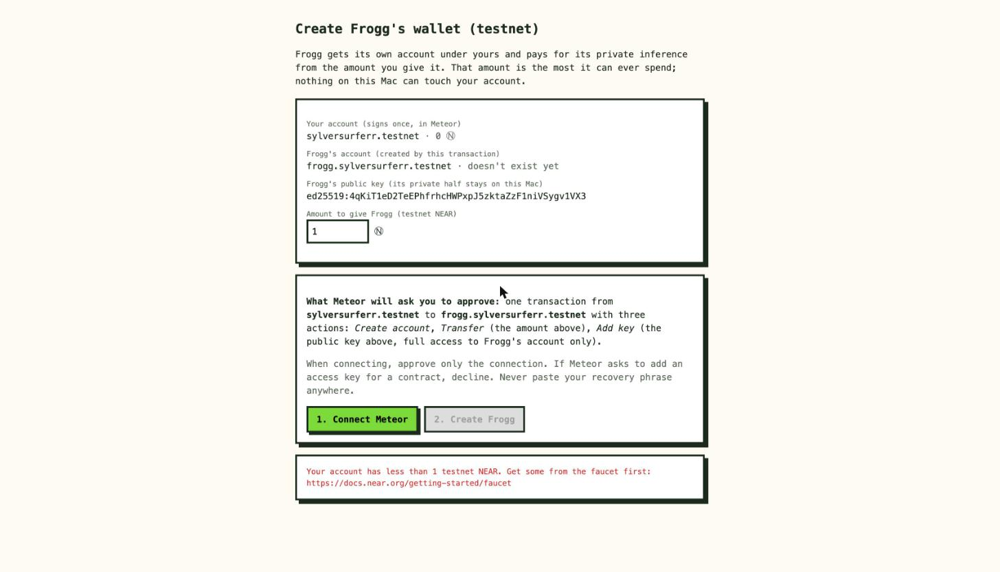 | 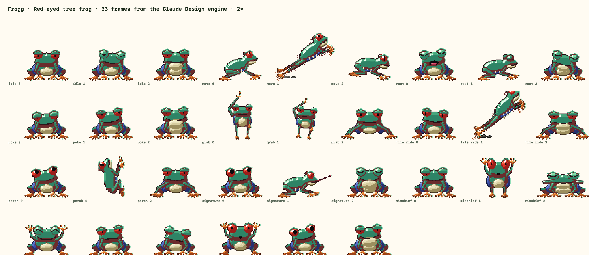 (and [`cat`](docs/screenshots/cat-frames.png), [`shiba`](docs/screenshots/shiba-frames.png), [`ghost`](docs/screenshots/ghost-frames.png), [`widow`](docs/screenshots/widow-frames.png), [`slugg`](docs/screenshots/slugg-frames.png)) |
| `/wallet/setup`: the owner approves Frogg's account in Meteor. | Frogg's frames (behavior slots, emotions, blink and his 12-step pond sleep), exported from the Claude Design engine (C7–C14) by `scripts/render-pixls.mjs`; Kiti adds walk 8 / trot 6 / climb 6, Mochi trot 6, Slugg crawl 8 and ceiling 6 with a separate shell layer. |

App screenshots are rendered offscreen from the app's own views (`swift run --package-path macos/PixlMemory pixl-snapshots <reply.json> docs/screenshots`). Browser screenshots are from Chrome.

## The problem

Writing assistants see everything you write: unsent emails, medical notes, contracts. "We don't train on your data" is a promise you can't check. Pixl Memory lets you check: the model runs in an enclave whose code and hardware are attested, and your Mac verifies that **before** sending, not after.

## Try it

**Install the Mac app (one command):**

```sh
git clone … && cd pixlz-near
scripts/install.sh        # sets up the service, builds and opens Pixl Memory.app
```

Then **click the frog in the menu bar** to call your Pixl: it springs out of the icon onto the window you're working in. Right-click the frog for the menu (Open at login, Pixl settings, Hide…). The app starts its own memory service; no terminal after this. *Not yet a download:* a standalone `.dmg` needs the service bundled and an Apple Developer ID for Gatekeeper, which come after judging.

**The verification works today with no account:**

```sh
make -C memory                       # 85 tests, then starts the local service
# or
cd memory && uv run pixl-memory attest
```

Requires [uv](https://docs.astral.sh/uv/) (`brew install uv`). It installs Python 3.12 and every dependency.

| Do | See |
|---|---|
| `uv run pixl-memory attest` | 14 checks against the live NEAR AI Cloud: Intel TDX quote and TCB, your nonce inside the signed quote, signing key bound, RTMR3 replay, measured docker-compose, NVIDIA GPU attestation, deployment log |
| `cp .env.example .env`, set `NEAR_AI_API_KEY`, then `uv run pixl-memory polish "teh frog sit on the windw"` | the polished text plus the verdict; the response signature recovers to the attested model key |
| `uv run pixl-memory serve`, then `POST /polish` | JSON with suggestion, word diff, and the full verification |
| Load `extension/` unpacked in Chrome (with the app installed it connects through native messaging, no token needed), select text → right-click **Save to Pixl Memory** (⌥⇧S) | the frog toolbar popup lists it; its link reopens the page highlighted at that passage ([`extension/README.md`](extension/README.md)) |
| `scripts/build-mac-app.sh --open`, allow Accessibility, select text in any app, click Frogg → **Polish this** | Frogg hops onto the active window; the panel shows the word diff, the verdict and all 17 checks; drag the green-edged card into your text (dropped on or right beside the text you selected, it takes that text's place) |
| Double-click the Pixl → **Ask** (⌃⌥Space) and type **"open Spotify"**, **"go to github.com"**, **"play Daft Punk on Spotify"** | done on the Mac with no model: the app if it's installed, otherwise the site in a new browser tab |
| On an article, Ask **"save this as frog research"** (select a passage first to save just that) | saved to Memory with a backlink: a text-fragment link to the passage through the extension, or the page's address read through Accessibility |
| On an article, Ask **"save the part about their transparent skin"**, or in one go **"go to en.wikipedia.org/wiki/Glass_frog and save the part about their transparent skin"** | the passage about it is found on the Mac (no model) and saved with a link that opens the page scrolled to it, highlighted |
| Ask **"what did I save about glass frogs?"** | your saves about it, ranked on the Mac, each with its backlink |
| Ask **"famous Chicago landmarks"** | the answer, with a row of pictures of the places it names (click to enlarge) |
| Double-click the Pixl → **Play**: Slugg's **Inevitable** (he crawls after your cursor along edges, and on a slime strand across open desktop; click him to bonk him into his shell) or Frogg's **Snap** (a drawn fly rides your cursor; dodge his tongue when his throat puffs) | 60 s rounds, best scores in the menu bar menu; typing or clicking another app ends a game at once. Script and tuning: [`docs/DEMO.md`](docs/DEMO.md) |
| Ask **"tell me a joke"** or **"what's new with NEAR AI this week?"** | the model searches the web when it needs to (NEAR AI's `web_context_search`, $0.005 a search); the card lists the pages it found. Search answers are signed by NEAR AI's attested gateway, so the verdict says "partly verified" (every check passes; the gateway, not the model enclave, signs) |
| Run Pixl on two Macs on the same Wi-Fi (or a second copy: `open -n --env PIXL_DEVICE_ID=demo --env "PIXL_DEVICE_NAME=Demo" ~/Applications/Pixl\ Memory.app`), allow Local Network, double-click the Pixl → **Send to Demo** | the other device asks "Catch …?"; on yes the Pixl leaps off this screen and springs out of the other one's menu bar. Ask "what screens are available?" or "jump to Demo" (answered on the Mac, no model) |
| `cd memory && uv run python attack_demo.py` | 21 attacks against the real code: forged/stale/debug enclaves, models outside a TEE, tampered or unattested replies, a compromised app holding Frogg's key, a malicious web page, a leaked key in a commit. All blocked; one (stolen key file) limited to Frogg's own balance. Log: [`docs/ATTACKS.md`](docs/ATTACKS.md) |
| `uv run pytest` | forged reports rejected: wrong nonce, swapped signer, tampered compose or event log, debug TD, failed GPU, unattested signer; "attestation fails → text is never sent" |

Full details: [`memory/README.md`](memory/README.md).

## Agents: watch and message your Claude Code sessions

Agent mode (SPEC §16) lists the Claude Code sessions on this Mac, answers their permission requests, and now talks back: open **Chat** on a session to read its transcript and send it a message. Connect once: double-click the Pixl → **Agents** → **Connect Claude Code** (it adds Pixlz hooks to `~/.claude/settings.json`, with your yes; connected before this version? the list shows **Update the hooks**).

| Do | See |
|---|---|
| Double-click the Pixl → **Agents**, pick a session (**Chat**) | a panel beside the Pixl: the session's transcript (auto-refreshing), what it's doing, and a field. Under the field: how your message will go |
| While it works, type a message and press Return (**"Sends at its next step"**) | at its next tool call, Claude gets it as context ("Message from the user via Pixlz: …"); the message shows *delivered (at its next step)* |
| When it finishes a turn, the Pixl asks **"<project>: done. Anything else?"** → **Reply** (or type in an open panel: **"Sends now"**) | your reply goes straight in and it carries on. No reply within the window (60 s by default; **Reply window** in the list), or **Dismiss**: it stops as usual |
| Message a session that's closed or has been quiet for 2 min (**"Resumes the session"**) | Pixlz runs `claude -p --resume <id>` in its folder and streams the reply into the panel; its permission requests come to the Agents list for Allow / Deny. If it was heard from in the last 2 minutes, you confirm first ("may still be open in a terminal") |
| Drag the panel's title bar away from the Pixl / back onto it; drag any edge or corner; double-click the title | tear it off into its own window / dock it again; resize (min 320 × 240); snap between compact and tall. Size and place are remembered per session |

Only what you type in a chat panel can reach a session (nothing the Pixl's AI, memory or NEAR inference produces can). Pixlz never blocks a stop twice in a row without a new message from you, so it can't loop a session. **Transcripts never leave your Mac:** they're read from `~/.claude/projects/` (that folder only) for the panel, never sent anywhere, and never to NEAR AI. Hooks answer instantly; if Pixlz isn't running they exit at once and Claude Code carries on.

## How it works

```
 macOS overlay (Frogg)      Chrome extension
   select → polish → diff     highlight → save → #:~:text= backlink
        \                     /
         127.0.0.1:7341  pixl-memory  (encrypted SQLite, token auth)
                │  1. attest: nonce → Intel TDX + NVIDIA NRAS + signer binding
                │  2. only then: completion (exact bytes kept)
                │  3. signature over sha256(request):sha256(response) → attested key?
                ▼
        NEAR AI Cloud  ── gateway TEE ── model TEE (z-ai/glm-5.3-flash)
                │
        Frogg's wallet  frogg.pixlz-petz-faucet.testnet  ── transfer(cost) ─▶ payee pixlz-petz.testnet (allowlisted)
```

| Part | Status |
|---|---|
| `memory/`: local service, verification, encrypted store, web search, CLI | **working**, 100 tests |
| Frogg's wallet: `frogg.pixlz-petz-faucet.testnet`, funded by its owner account, pays `pixlz-petz.testnet` per request | **live on testnet**: every answer pays its cost on chain ([first payment](https://testnet.nearblocks.io/txns/GzuymmDA5kERz74Rj28GAs8KaSUqAiM8DtgvkBui9fzm)); 20 wallet tests against a simulated chain |
| `macos/PixlMemory/`: overlay app. Frogg perches on the active window, hops when you switch windows, and startles then hops to the new perch when you swipe to another Space (an edge pop when an arc between two displays would leave the screen). Behavior: Calm, Roam or Chaos (each Pixl explores in its own style with real walk/trot/crawl loops: Kiti walks, Mochi trots, Slugg never hops: he does a two-step crawl (front first, the back catching up), climbs the screen's real edges and window sides, laps over the top upside down (now and then his shell lets go first and he tumbles onto it), wraps head first around corners and over window tops, and leaves a green slime trail that fades in 2 s; his shell lags and settles, opens like a vault for Memory and seals for Focus, Silky climbs walls and hangs on silk, Boo hovers and glides; never while you type, never over your caret; if it's sitting where you're about to type, it moves away). Ask does things: opens apps and sites, saves the page or the part about a topic with a backlink, finds what you saved, searches the web, shows pictures. Play: two mini-games (C16). Sleeps when you're away (Frogg in his pond), wakes by the rules in SPEC §6.2. Text in three channels: sounds in bubbles, status narration, plain-English notices. Click to poke; double-click, right-click or press-and-hold for the option bubbles (Polish when text is selected → diff → drag the result into your text; otherwise Ask; Memory; Wallet; More); drag to grab and toss; menu bar item; ⌃⌥P / ⌃⌥Space / ⌃⌥H; Focus timer; hides in fullscreen | built; 173 unit/UI tests (+11 UI, +137 in PixlzCore) plus an in-app click self-test (`scripts/build-mac-app.sh --selftest`); installs to `~/Applications`, `--debug` logs every click |
| `extension/`: Chrome highlight → save → text-fragment backlink; bridge to the Mac app (native messaging): highlights recalled in Ask with backlinks, Polish → Replace inside web pages and rich editors | built, 15 tests + 11 bridge protocol tests (one runs the real host binary); run in Chrome (see the backlink screenshots above) |

Plan and design notes: [`docs/PLAN-pixl-memory.md`](docs/PLAN-pixl-memory.md).

## Scope of this submission

**One device, done properly.** The submission is the Mac app, the Chrome extension and the local memory service, working end to end. Everything else in the Pixlz plan is deliberately left for after judging, so nothing here is half-built.

**Skins are part of the draw.** Frogg is the launch pet. The demo ships six Pixls from the Pixlz Design System (Frogg, Kiti, Mochi, Boo with its body and menus in macOS Liquid Glass, Silky and Slugg), each with two alternate skins. Each has its own accent, bubble detail and signature move. Switching skins keeps your memory, wallet, position and settings. Skins in this submission are a plain picker, not tokens.

**Next, after the hackathon, in this order:**
1. **On-chain skins.** Skins as NEAR NFTs (NEP-171) owned by your wallet and read by the app, so a pet you own follows your account.
2. **iPhone companion.** Reuses the shared Swift core (`PixlzCore`): Frogg on a small stage, plus a widget.
3. **Mac ↔ iPhone travel.** The pet hops between nearby devices, built on the trip protocol already in `PixlzCore` (baseline).
4. **Windows app (WPF)**, built from `docs/SPEC.md`.
5. **Cloud-relayed travel**, so the pet can move between Windows, Mac and iPhone across networks.

Each step reuses the one before it: the iPhone app gives travel a second endpoint, Apple-to-Apple travel proves the protocol before a second platform and a server are added, and the cloud relay comes last because it is the only step that needs accounts and a backend.

## Frogg's wallet: why your funds stay untouchable

Every Pixl can have its own NEAR wallet: a sub-account the owner creates and funds, which is its spending cap. The demo video shows Frogg's (`frogg.pixlz-petz-faucet.testnet`); other pets use the same flow (`pixl-memory wallet init --pet kiti`, then the owner creates `kiti.<owner>.testnet` with that key). Each Pixl pays for its own thinking from its own account, with its own daily and weekly limits.

**Choice: a plain NEAR sub-account that the owner funds: `frogg.pixlz-petz.testnet`, under the owner's testnet account `pixlz-petz.testnet`.** We considered a NEAR Intents agent account (the Agent API) and rejected it for this app.

**How it works:**
- **The owner creates `frogg.<owner>.testnet` from their own wallet and sends it a small amount** (live: `frogg.pixlz-petz-faucet.testnet`, made with the NEAR CLI because Meteor blocks full-access keys). The owner approves every transaction from their own wallet; the app never asks for a recovery phrase or private key. Your keys are never on the Mac, and NEAR gives a parent account no control over a sub-account after creation. Pixl Memory has no path to your main account.
- **The app holds only Frogg's own key, for Frogg's account.** The most a stolen key can spend is the balance you chose to give Frogg. That balance is the hard cap, enforced by NEAR itself.
- **Frogg pays per request with a plain NEAR transfer.** The recipient is the account that holds the NEAR AI credits (you, or whoever runs the service). There is no documented way to buy NEAR AI credits on-chain; they're bought in its dashboard. The amount is the request's real cost from `/v1/billing/costs`, converted at a rate you set. The app refuses to pay any other recipient.
- **Your balance and receipts appear in Frogg's thought bubble.** On chain is only the amount and transaction. The receipt itself (model, cost, verification verdict) stays in the local encrypted store.
- **A second cap you can add:** set a USD spend limit on your NEAR AI API key in the cloud.near.ai dashboard. NEAR AI enforces it per key.

**Why not a NEAR Intents agent account** (checked 2026-11-08 against docs.near-intents.org and the `NEAR-Intents-Agent-API` SDK and skills):

| | NEAR Intents Agent API | Funded sub-account |
|---|---|---|
| Network | **Mainnet only**, real funds ("experimental, mainnet-only beta") | **Testnet** first, free |
| Credentials in the app | A partner API key, which the docs say must **never ship in an app**, so it needs our own backend; plus a grant token | One key, for Frogg's account only |
| Setup | Owner-signed intents to create the account, set policy, issue a grant | One account-creation and one transfer, from your wallet |
| Limits | Rich policy (destinations, budgets, schedules, freeze), enforced by the service | Balance = hard cap, enforced by the protocol; recipient allowlist in our code |
| NEAR AI integration | None | None (same) |
| Code for us | SDK (Node 24) + backend proxy + owner-signing flow | Sign and send one transfer |

Both keep your main funds untouchable. The sub-account does it with far less code, works on testnet, and needs no server.
- The Agent API's server-side policy engine is the stronger tool for an agent that holds large balances. It is the upgrade path if Frogg ever does.
- A smaller step is to deploy a tiny policy contract on Frogg's account and give the app only a function-call key for its `pay_inference` method. NEAR function-call keys can't transfer NEAR or add keys, so a stolen key could then only pay the fixed payee within per-call and daily limits. We list that as optional hardening, not part of the first build.

**How it's built** (`memory/src/pixl_memory/near.py`, `wallet.py`):
- **Signing.** Frogg's ed25519 key is generated on the Mac (`pixl-memory wallet init`) and stored in `~/Library/Application Support/PixlMemory/frogg_key.json` (0600). Transactions are signed in about 100 lines of Python, checked byte-for-byte against `near-api-js` in the tests.
- **Before every payment,** in order: the per-request cap, the per-day cap, the payee allowlist and the reserve. Only then is anything signed. A polish is refused up front once the daily cap is reached, so your text isn't sent if Frogg can't pay.
- **What's on chain is a plain NEAR transfer:** sender, receiver, amount and time. No text, model or verdict is attached. The full receipt is stored only in the local encrypted database.

**Owner setup** (testnet only; the owner never shares a recovery phrase or key):
1. `cd memory && uv run pixl-memory wallet init`. This creates Frogg's key and prints its public half.
2. Create Frogg's account under yours, with that public key and a small amount. From the NEAR CLI (the owner's key stays in your keychain):
   `near create-account frogg.<you>.testnet --use-account <you>.testnet --public-key <Frogg's public key> --initial-balance 1 --network-id testnet`
   (No testnet NEAR? `near create-account <you>.testnet --use-faucet --network-id testnet` makes a funded account.)
3. Set `FROGG_PARENT_ACCOUNT`, `FROGG_ACCOUNT` and `FROGG_PAYEE` in `.env`; `uv run pixl-memory wallet status` should end with READY.

The `/wallet/setup` page does the same step from a browser wallet, but Meteor refuses any transaction that adds a full-access key, and Frogg needs one on its own account to pay. Our live setup used the CLI: the owner `pixlz-petz-faucet.testnet` (a faucet-funded account) created `frogg.pixlz-petz-faucet.testnet`; payments go to `pixlz-petz.testnet`, the owner's Meteor account.

Testnet only: the config refuses mainnet RPCs and anything but `frogg.<owner>.testnet`.

## Keys and secrets

This repo is public, so **API keys live only in `.env`**, which is git-ignored. Copy `.env.example` (empty values) to `.env` and fill in `NEAR_AI_API_KEY`. The service reads keys from that file only: not from code, arguments or the shell environment. It never prints them.

`scripts/check-secrets.sh` blocks commits containing anything key-shaped or any `.env` file. Turn it on per clone with `git config core.hooksPath .githooks`. The test suite runs it over every tracked file.

Frogg's own NEAR key isn't an API key. It's stored outside the repo, in `~/Library/Application Support/PixlMemory/` (mode 0600).

## Baseline vs hackathon work

Pixlz is the owner's existing desktop-pet project. This entry adds the NEAR integration on top of it.

**This repository holds only what the hackathon entry needs to build, run and test.** It is extracted from the private Pixlz repository with its history kept, so every commit keeps its original date. Left out, because the entry doesn't need them: the Claude Design source (`design/`), the iOS and Windows plans, and the product research notes. The pixel art is already exported into `assets/` and embedded in the app, so nothing here depends on them; `scripts/render-pixls.mjs`, which re-exports the art, needs the design source and only runs in the private repository.

| | Commits | Dates |
|---|---|---|
| **Baseline**, tag [`pre-hackathon`](https://github.com/devluca999/pixlz-near/tree/pre-hackathon) | every commit up to the tag | 2026-10-15 22:40 CT → 2026-10-16 02:48 CT, all before the 2026-10-19 announcement |
| **Hackathon work**, tag `hackathon-submission` | everything after | started 2026-11-08 |

**Diff of all hackathon work:** https://github.com/devluca999/pixlz-near/compare/pre-hackathon...hackathon-submission

- **Baseline:** `PixlzCore/` (pet needs, behavior, world map, physics, PetState, Mac↔iPhone travel protocol), `docs/SPEC.md`, `docs/DECISIONS.md`, `assets/` (later re-exported during the hackathon).
- **New in the hackathon:** `memory/`, `macos/PixlMemory/` (including the generated `FroggSpriteData.swift`), `extension/`, `scripts/`, `.githooks/`, `.env.example`, `docs/PLAN-pixl-memory.md`, decision D15, and this README.

Pixlz also plans a **Solana** layer. It is not part of this submission.

**Our other, independent entry: Evernear** (shipment escrow).

## Libraries and AI use

**`memory/`** (Python 3.12, managed with uv):

| Library | Used for |
|---|---|
| [FastAPI](https://fastapi.tiangolo.com) + [Uvicorn](https://www.uvicorn.org), Pydantic | local HTTP API |
| [httpx](https://www.python-httpx.org) | HTTP client |
| [dcap-qvl](https://github.com/Phala-Network/dcap-qvl) (Phala) | Intel TDX quote verification |
| [eth-account](https://github.com/ethereum/eth-account) | EIP-191 signature recovery |
| [cryptography](https://cryptography.io) | AES-GCM at rest |
| [python-dotenv](https://github.com/theskumar/python-dotenv) | reads API keys from `.env` |
| pytest, hatchling | tests, build |

**External services:**
- NEAR AI Cloud: inference, attestation, signatures.
- NVIDIA Remote Attestation Service: GPU evidence.
- Phala PCCS: Intel collateral.

**Baseline:** Swift 6, Swift Package Manager, no third-party Swift packages.

**`extension/`:** no libraries, no build step (plain JavaScript modules; tests use Node's built-in `node --test`).

**Wallet:** no new Python libraries: ed25519 comes from `cryptography`, and Borsh and base58 are written in `near.py`. The setup page loads [`@near-wallet-selector/core` and `meteor-wallet`](https://github.com/near/wallet-selector) 10.1.4 and `@near-js/transactions` / `@near-js/crypto` 2.5.1 from esm.sh. The encoding test vector was generated with `@near-js/transactions` 2.x.

**`macos/PixlMemory/`:** AppKit, ApplicationServices (Accessibility, read-only), Swift Testing, and the baseline `PixlzCore` (hop physics). No third-party packages. The Pixls' frames are exported from the owner's Claude Design engine (private, not in this repository) by `scripts/render-pixls.mjs` and embedded as text: no PNGs.

The wallet code will list its libraries here when it lands.

**AI-generated content:**
- The hackathon code, tests and docs in this branch were written with **Claude Code** (Anthropic, Claude Opus 5.5), directed and reviewed by the owner.
- The pixel art was designed in Claude Design and exported by a script; the design source stays in the private repository.
- The demo video's narration is a synthetic voice ([Chatterbox](https://github.com/resemble-ai/chatterbox), run locally by `showcase/narrate.py`). The cut, captions and the device render in its last scene were made by scripts in `showcase/`.
- The test fixture `memory/tests/fixtures/attestation_report.json` is a real NEAR AI Cloud attestation response, captured 2026-11-08.

## Showcase mode and the demo video

The demo video is recorded from the app itself. **Showcase mode** is a recording aid, only on with `--showcase` (or `PIXL_SHOWCASE=1`) and never in a normal run. It plays named scenes made of beats, each one a real feature triggered on cue: the fly, the wallet card, the attestation card, a paid private answer, a highlight saved to memory, the guard on a risky command.

- **Hotkeys:** ⌃⌥K next beat · ⌃⌥⇧K previous · ⌃⌥R restart the scene · Esc reset. Or hands-free: `PixlMemory showcase run <scene>`.
- **Takes match.** Random choices use one fixed seed. A beat that waits on something live (inference, attestation, testnet) shows a spinner and moves on when it lands.
- **Nothing private in a take.** A plain dark desk covers the desktop; scenes that need a page, a draft or a repo use the throwaway ones in `showcase/demo/`.
- **Recording and cutting:** `showcase/record.sh <scene> <take> <seconds>` records a take; `showcase/cut.py` assembles the 9:16 cut and the 16:9 judges' cut from `showcase/edit.json`, with burned-in captions and the narration.

The scenes, the narration and the steps are in [`showcase/SHOTLIST.md`](showcase/SHOTLIST.md); the caption rules in [`showcase/CAPTIONS.md`](showcase/CAPTIONS.md).

The video's last scene shows a Mosaico display, a Mac and an iPhone side by side. That scene is a render, and the iPhone in it is labelled "coming soon": the iPhone companion is under **Next** in [Scope of this submission](#scope-of-this-submission), not in this submission.

## Repository layout

```
memory/      Hackathon: local service, NEAR AI private inference + verification
macos/       macOS app; PixlMemory/ overlay is hackathon work
extension/   Hackathon: Chrome extension (highlight → save → backlink)
PixlzCore/   Baseline: shared Swift package (pet state, behavior, travel)
showcase/    Hackathon: demo video (shot list, recorder, cut, narration, demo pages)
docs/        SPEC.md, DECISIONS.md (baseline); PLAN-pixl-memory.md, screenshots (hackathon)
assets/      The Pixls' manifests and exported frames
```

Baseline core tests: `swift test --package-path PixlzCore`.

## License

Copyright © 2026 Luca M. All rights reserved. See [`LICENSE`](LICENSE).
Published publicly for NEAR Hackathon judging. No license is granted.
